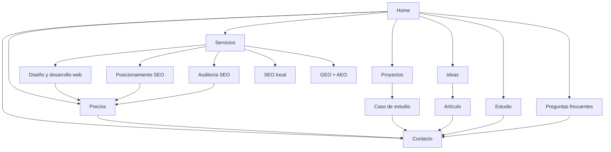

# RDS · Variante 02 — “Señales claras”

**Documento maestro para generar, conectar y probar un mockup web funcional en Google Stitch.**

- **Marca:** Rangel Designs Studio, RDS®
- **Tipo de proyecto:** Rediseño exploratorio / variante de diseño
- **Herramienta objetivo:** Google Stitch
- **Idioma:** Español de Chile
- **Fecha de esta versión:** 25 de noviembre de 2026
- **Estado:** Hipótesis de diseño, no reemplazo automático del sitio actual
- **Objetivo del entregable:** Generar una web multipágina navegable, visualmente reconocible y lista para validar con personas antes de implementarla.

> **Uso responsable del contenido:** precios, servicios y condiciones provienen del sitio actual de RDS. Los proyectos, testimonios y métricas deben ser reales y autorizados. Donde este documento use contenido de muestra, está marcado como **DEMO**.

---

## 0. Cómo usar este archivo

### Ruta rápida en Google Stitch

1. Crea un proyecto llamado **“RDS · Variante 02 — Señales claras”**.
2. Usa formato **Web / Desktop**, frame base de **1440 × 900 px**.
3. Carga o configura primero el sistema visual de la sección **5. Sistema de diseño**.
4. Genera la pantalla **Home desktop** con el **Prompt maestro** de la sección **16**.
5. Itera con ajustes pequeños. No regeneres todo si solo falla una sección.
6. Genera la versión **Mobile / 390 × 844 px** desde la Home ya aprobada.
7. Genera las demás pantallas con los prompts individuales de la sección **17**.
8. Conecta los botones según el flujo de la sección **10**.
9. Añade los estados de interacción de la sección **18**.
10. Revisa accesibilidad, responsive y calidad con la sección **21**.

### Si Stitch tiene un sistema de diseño o `DESIGN.md`

- Copia las secciones **5, 6 y 7** a un archivo separado llamado `DESIGN.md`.
- Aplica ese sistema al proyecto antes de generar pantallas.
- En ese caso, usa los prompts **sin repetir colores ni tipografías**. Stitch debe heredarlos del proyecto.

### Si usas la interfaz web de Stitch sin sistema de diseño cargado

- Ajusta manualmente el tema con los colores y fuentes de la sección 5.
- Si el prompt necesita contexto visual, usa la versión **autónoma** del prompt maestro.
- Mantén el mismo proyecto y los mismos tokens durante todas las pantallas.

### Nombres sugeridos para las pantallas

1. `01 · Home`
2. `02 · Home Mobile`
3. `03 · Servicios`
4. `04 · Diseño Web`
5. `05 · SEO Mensual`
6. `06 · Precios`
7. `07 · Proyectos`
8. `08 · Caso de Estudio`
9. `09 · Estudio`
10. `10 · Ideas`
11. `11 · Artículo`
12. `12 · Preguntas Frecuentes`
13. `13 · Contacto`
14. `14 · Contacto · Estado de Éxito`

---

## 1. Resumen ejecutivo

RDS es un estudio digital chileno que diseña y desarrolla sitios web, trabaja posicionamiento SEO, audita sitios existentes y prepara información para búsquedas locales y asistentes de IA.

La variante **“Señales claras”** parte de una idea sencilla: una buena web no debe limitarse a verse bien. Debe hacer que el negocio correcto sea **entendido, recordado, encontrado y elegido**.

La experiencia propuesta convierte esa idea en un sistema visual y funcional:

- Un **tablero de señales** en el hero, que representa búsqueda, claridad y visibilidad.
- Dos rutas comerciales explícitas: **crear una web** o **hacer crecer un sitio existente**.
- Un **selector de proyecto** que ayuda al visitante a encontrar el punto de partida sin conocer la jerga.
- Precios y límites visibles para reducir incertidumbre.
- Diseño editorial táctil, con bordes definidos, tipografía expresiva y colores de señal.
- Fotografías de equipo y stock genérico reemplazadas por piezas gráficas propias, capturas y documentos reales.

La variante debe sentirse como **un estudio que piensa y construye**, no como una plantilla de agencia tecnológica.

---

## 2. Brief estratégico

### 2.1 Negocio

**Nombre comercial:** Rangel Designs Studio

**Marca corta:** RDS®

**Fundador:** Armando Rangel

**Correo visible:** `hola@rangel.design`

**Territorio comercial:** Chile y Latinoamérica, con foco de servicio en Santiago y la Región Metropolitana.

**Qué vende:**

- Diseño y desarrollo de sitios web.
- Rediseño de sitios existentes.
- Diseño web para empresas.
- Posicionamiento SEO mensual.
- Auditoría técnica y SEO.
- Implementación de correcciones después de una auditoría.
- SEO local y páginas por zonas reales.
- GEO y AEO para mejorar la claridad de la información ante buscadores y asistentes de IA.

### 2.2 Problema que debe resolver la web

Muchos negocios tienen una web, pero no una presencia digital clara. Publican, cambian colores o compran anuncios sin definir qué debe entender el visitante, qué debe hacer después ni cómo se medirá el resultado.

RDS debe ayudar a distinguir entre:

1. Necesito crear una web.
2. Ya tengo una web y quiero mejorarla.
3. Necesito trabajo continuo de visibilidad.
4. Necesito una solución puntual de SEO local o contenido.

La confusión entre esos puntos de entrada es una de las principales causas de consultas mal calificadas.

### 2.3 Públicos prioritarios

| Segmento | Necesidad principal | Objeción típica | Qué debe encontrar |
|---|---|---|---|
| Pymes de servicios | Captar consultas con una web clara | “¿Cuánto cuesta y qué incluye?” | Precio base, alcance, proceso y contacto simple |
| Profesionales independientes | Tener presencia profesional sin un proyecto innecesariamente grande | “No sé si necesito una landing o un sitio” | Selector de proyecto y opción de entrada accesible |
| Empresas establecidas | Ordenar varios servicios y mejorar su presencia | “Mi sitio actual ya funciona; ¿vale la pena tocarlo?” | Auditoría, protección y rutas separadas |
| Negocios locales | Ser encontrados en una zona real | “¿Me harán páginas falsas por comuna?” | Explicación honesta de cobertura, Maps y contenido útil |
| Empresas B2B | Construir autoridad y claridad comercial | “¿SEO e IA garantizan resultados?” | Expectativas reales, medición y metodología |

### 2.4 Objetivos del sitio, en orden

1. **Generar consultas calificadas.**
2. **Explicar la diferencia entre una web nueva y un sitio existente.**
3. **Reducir dudas sobre precio, alcance y propiedad.**
4. **Demostrar criterio de diseño y capacidad técnica.**
5. **Crear una base editorial que pueda posicionar y ser citada por buscadores y asistentes.**

### 2.5 Conversiones

**Conversión principal:** enviar el formulario de proyecto.

**Conversiones secundarias:**

- Explorar precios.
- Abrir un servicio concreto.
- Revisar casos de estudio.
- Leer una guía.
- Escribir directamente a `hola@rangel.design`.

### 2.6 Posicionamiento

**Categoría:** estudio digital de diseño web, desarrollo y visibilidad.

**Idea central:** RDS convierte la complejidad de tener una presencia digital en una ruta clara.

**Promesa creíble:** una web mejor estructurada, más coherente con el negocio y preparada para ser encontrada.

**Lo que RDS no promete:**

- Primera posición en Google.
- Citas o menciones garantizadas en IA.
- Posicionamiento local sin una ubicación o zona de servicio real.
- Resultados sin datos y autorización.

### 2.7 Personalidad

**Cinco atributos:**

1. **Claro:** explica antes de impresionar.
2. **Con criterio:** toma decisiones y puede fundamentarlas.
3. **Creativo:** tiene una voz y un sistema visual propios.
4. **Cercano:** conversa como un estudio, no como una fábrica.
5. **Responsable:** distingue diagnóstico, ejecución, mantención y resultados.

**Tono de voz:**

- Frases directas.
- Verbos concretos.
- Cero jerga sin explicación.
- Optimismo sin grandilocuencia.
- Profesional, chileno y neutro para Latinoamérica.
- Sin signos de exclamación en cadena.
- Sin “somos apasionados por el diseño” como argumento.

### 2.8 Hipótesis que valida el mockup

1. Si el visitante entiende su ruta en menos de 15 segundos, llegará con más contexto al formulario.
2. Si los precios y límites aparecen temprano, bajarán las consultas fuera de alcance.
3. Si la Home muestra criterio visual sin esconder la oferta, RDS se percibirá más experto y confiable.
4. Si los casos no inventan resultados, el portafolio aumentará credibilidad.
5. Si el selector de proyecto cambia contenido y CTA, la experiencia se sentirá funcional y no solo decorativa.

### 2.9 Métricas para probar el mockup

- Comprensión de “qué hace RDS” sin ayuda.
- Elección correcta de ruta según un escenario dado.
- Tiempo hasta encontrar precios.
- Claridad percibida del alcance.
- Intención de contacto.
- Recuerdo de la marca después de 10 segundos.
- Preferencia versus el sitio actual.

---

## 3. Alcance

### Incluido en el mockup

- Home desktop y mobile.
- Navegación global.
- Selector interactivo de proyecto.
- Páginas de servicios.
- Página de precios.
- Proyectos y plantilla de caso.
- Estudio.
- Ideas y plantilla de artículo.
- Preguntas frecuentes.
- Contacto y estado de éxito.
- Menú móvil.
- Acordeones.
- Estados hover, focus, active y disabled.
- Enlaces entre pantallas.

### Fuera del alcance inicial

- Backend real.
- Envío efectivo de formularios.
- CMS y autenticación.
- Dashboard privado.
- Pasarela de pago.
- Blog dinámico con base de datos.
- Tracking de campañas.
- Producción de casos, fotografías o videos definitivos.

---

## 4. Concepto creativo

### 4.1 Nombre interno

**“Señales claras”**

### 4.2 Idea visual

La web debe combinar tres lenguajes:

1. **Precisión de tablero de control:** coordenadas, etiquetas, rutas, líneas y estados.
2. **Calidez editorial:** papel cálido, titulares grandes, composición asimétrica y pequeños gestos gráficos.
3. **Trabajo de estudio:** piezas que parecen documentos, sistemas y prototipos reales.

El resultado no es una web “tecnológica”. Es una web de diseño con inteligencia operativa.

### 4.3 Metáfora interactiva

El hero incluye un **Mapa de Señales** compuesto por:

- Una ventana tipo navegador.
- Una consulta de búsqueda.
- Resultados esquemáticos.
- Marcas de claridad, relevancia y visibilidad.
- Una flecha o nodo que conecta “lo que haces” con “lo que buscan”.

No es una captura falsa de Google. Es una ilustración propia de RDS.

### 4.4 Titulares

**Headline principal:**

> TU WEB DEBERÍA ABRIR PUERTAS.  
> NO SOLO EXISTIR.

La segunda línea se destaca con violeta o naranja.

**Claim corto:**

> Diseño, estructura y visibilidad para que tu negocio se entienda y se encuentre.

**Tagline de marca:**

> Ideas claras. Diseño con carácter. Una web que sabe a dónde va.

### 4.5 Principios de diseño

- **Jerarquía antes que densidad:** una idea principal por bloque.
- **Asimetría controlada:** no todos los contenidos deben quedar centrados.
- **Bordes visibles:** las piezas se entienden como objetos.
- **Color con función:** cada color identifica una ruta o estado.
- **Movimiento intencional:** el movimiento explica relaciones; no adorna.
- **Prueba antes de afirmación:** cada claim importante debe conectar con alcance, método o evidencia.

### 4.6 Anti-patrones prohibidos

- Fondos con gradientes morados genéricos.
- Glassmorphism.
- Orbes 3D sin relación con la oferta.
- Cuadrícula de logos falsos.
- Métricas inventadas.
- Testimonios sin nombre y autorización.
- Fotos de stock de personas señalando pantallas.
- Texto gris claro sobre fondos saturados.
- Todas las tarjetas con radios de 24 px.
- Emojis como iconografía principal.
- “Scroll para descubrir”.
- Carruseles automáticos.
- Animaciones que retrasan la lectura.

---

## 5. Sistema de diseño

### 5.1 Intención visual

**Atmósfera:** editorial, precisa, cálida, ingeniosa y confiable.

**Densidad:** media. Suficiente aire para que el contenido respire, pero sin caer en una landing vacía.

**Superficie:** papel cálido, líneas de tinta y color en bloques claros.

**Profundidad:** sombras duras, desplazadas y pequeñas. Sin difuminados.

### 5.2 Paleta

| Token | Nombre descriptivo | Hex | Uso | Contraste |
|---|---|---|---|---|
| `paper` | Papel cálido | `#F4EFE5` | Fondo global | Texto tinta 16.59:1 |
| `ink` | Tinta casi negra | `#11100E` | Texto, bordes, botones | Base |
| `violet` | Violeta señal | `#5B4BFF` | Enlaces, etiquetas, foco, bloques | Papel encima 4.70:1 |
| `orange` | Naranja acción | `#FF7A45` | CTA principal y alertas suaves | Tinta encima 7.35:1 |
| `mint` | Menta resuelta | `#BDEBD0` | Ruta web, éxito y etiquetas | Tinta encima 14.45:1 |
| `lilac` | Lila estrategia | `#E0D9FF` | Ruta SEO, fondos secundarios | Tinta encima 14.07:1 |
| `sun` | Amarillo nota | `#F5DE67` | Notas, precios, detalles | Tinta encima 14.06:1 |
| `surface` | Papel secundario | `#E9E3D8` | Secciones alternas y campos | Tinta encima 14.89:1 |

**Regla:** el violeta y el naranja nunca compiten en el mismo botón. El CTA principal usa naranja; la navegación y los enlaces usan violeta.

### 5.3 Tipografía

| Rol | Fuente | Uso | Estilo |
|---|---|---|---|
| Display | Bricolage Grotesque | H1, H2 y palabras de impacto | 700–800, tracking `-0.05em`, line-height `0.92–1.0` |
| Interfaz y cuerpo | DM Sans | Párrafos, navegación, botones y formularios | 400–700 |
| Metadatos | IBM Plex Mono | Índices, labels, precios, coordenadas y estados | 500, tamaño 11–13 px, tracking `0.06em` |

**Escala desktop:**

- H1: 88–128 px.
- H2: 56–88 px.
- H3: 28–40 px.
- Lead: 20–24 px.
- Body: 17–18 px.
- Small: 14 px.
- Metadata: 11–13 px.

**Escala mobile:**

- H1: 48–64 px.
- H2: 36–48 px.
- H3: 24–30 px.
- Lead: 18–20 px.
- Body: 16–17 px.

**Fallbacks:** `Bricolage Grotesque`, `Arial Black`, sans-serif; `DM Sans`, Arial, sans-serif; `IBM Plex Mono`, monospace.

### 5.4 Forma, borde y profundidad

- Bordes: 1 px de tinta en superficies comunes; 2 px en piezas interactivas.
- Radios: 0 px por defecto; 8 px solo en tarjetas y campos; radios completos solo en chips.
- Sombra suave de tarjeta: `4px 4px 0 #11100E`.
- Sombra hover: `7px 7px 0 #11100E`.
- Botón hover: desplazar `-2px, -2px` y mostrar sombra de 4 px.
- No usar blur, vidrio, transparencias decorativas ni sombras difusas.

### 5.5 Espaciado

Escala base:

`4, 8, 12, 16, 24, 32, 48, 64, 80, 96, 120, 160`

- Secciones desktop: 96–160 px verticales.
- Secciones mobile: 64–96 px verticales.
- Separación entre título y cuerpo: 20–32 px.
- Separación entre bloques: 48–72 px.
- Gap de grid desktop: 24 px.
- Gap mobile: 16 px.

### 5.6 Layout

- Ancho máximo: 1440 px.
- Contenido útil: 1280 px.
- Grilla desktop: 12 columnas.
- Gutter lateral desktop: 72–88 px.
- Gutter lateral tablet: 40 px.
- Gutter lateral mobile: 20 px.
- Breakpoints de referencia: 1200, 960, 760, 480 px.

### 5.7 Iconografía

- Usar líneas de 1.5–2 px.
- Flecha noreste `↗` para explorar.
- Flecha derecha `→` para avanzar.
- Asterisco `✳` como marca de RDS, no como icono universal.
- El botón de menú cerrado se representa con tres líneas o dos barras; abierto con una X.
- Nada de emojis en navegación, botones o formularios.

---

## 6. Componentes globales

### 6.1 Header desktop

**Altura:** 80 px.

**Fondo:** papel; borde inferior de 1 px tinta.

**Distribución:** tres zonas.

**Izquierda:**

```text
RDS®
RANGEL DESIGNS STUDIO
```

**Centro:**

```text
Servicios · Precios · Proyectos · Ideas · Estudio
```

**Derecha:**

```text
[ Cuéntame tu proyecto ↗ ]
```

**Estados:**

- Link default: tinta.
- Hover: violeta y subrayado de 2 px.
- Activo: punto violeta de 6 px antes del label.
- CTA: fondo tinta, texto papel.
- Al hacer scroll: el header permanece sticky y añade una línea inferior más definida.

### 6.2 Header mobile

- Altura: 68 px.
- Logo a la izquierda.
- CTA corto opcional: `Hablemos`.
- Botón de menú de 44 × 44 px a la derecha.
- Menú abierto a pantalla completa, sobre papel.
- Links en 28 px, alineados a la izquierda.
- CTA final de ancho completo.
- Cerrar con X, Escape o selección de un link.

### 6.3 Botones

**Primario**

- Fondo naranja.
- Texto tinta.
- Borde 2 px tinta.
- Altura mínima 52 px.
- Padding 14 × 20 px.

**Secundario**

- Fondo transparente.
- Texto tinta.
- Borde 1 px tinta.

**Invertido**

- Fondo tinta.
- Texto papel.

**Texto**

- Link con borde inferior.
- Flecha incluida.

**Estados:**

- Hover: desplazamiento y sombra.
- Focus: contorno violeta de 3 px y offset de 3 px.
- Active: vuelve 1 px hacia abajo.
- Disabled: 35% de opacidad y cursor no permitido.

### 6.4 Tarjeta de servicio

Contenido:

1. Número y categoría.
2. Título.
3. Descripción de una o dos líneas.
4. Link “Conocer el servicio ↗”.

Formato:

- Fondo menta, lila, naranja o amarillo.
- Borde 1 px.
- Sombra dura.
- Altura mínima 300 px.
- Hover: sube 3 px, sombra 7 px.

### 6.5 Chips

- Forma de píldora.
- Borde de 1 px.
- Altura 32–36 px.
- Label en IBM Plex Mono.
- Activo: fondo tinta, texto papel.

### 6.6 Acordeón

- Fila con borde superior e inferior.
- Pregunta a la izquierda.
- Signo `+` a la derecha.
- Abierto: cambia a `×`, aumenta el espacio y muestra respuesta.
- Una sola pregunta abierta a la vez en el bloque de Home.
- En FAQ se permite más de una.

### 6.7 Formulario

- Labels visibles arriba.
- Campos de 52 px mínimo.
- Fondo `surface`.
- Borde 1 px tinta.
- Focus: borde violeta de 2 px más contorno exterior.
- Error: borde y mensaje con rojo accesible `#B42318`.
- Éxito: fondo menta y borde tinta.

### 6.8 Footer

**Fondo:** tinta.

**Color de texto:** papel.

**Columnas desktop:**

1. Marca + tagline + email.
2. Explora.
3. Servicios.
4. Siguiente paso.

**Contenido:**

```text
RDS®
Ideas claras. Diseño con carácter.
Una web que sabe a dónde va.

hola@rangel.design ↗

EXPLORA
Servicios
Precios
Proyectos
Ideas
Estudio
Preguntas frecuentes

SERVICIOS
Diseño y desarrollo web
Rediseño web
Diseño web para empresas
Posicionamiento SEO
Auditoría SEO
SEO local
GEO + AEO

SIGUIENTE PASO
¿Tienes una idea?
Cuéntame tu proyecto ↗
```

**Barra inferior:**

```text
© 2026 RANGEL DESIGNS STUDIO
CHILE + LATINOAMÉRICA
VOLVER ARRIBA ↑
```

---

## 7. Movimiento e interacción

### Principios

- Duración estándar: 180–280 ms.
- Easing: `cubic-bezier(0.2, 0.8, 0.2, 1)`.
- Entrada de secciones: 12–20 px de desplazamiento, nunca más.
- Sin parallax pesado.
- Respetar `prefers-reduced-motion`.

### Microinteracciones

| Elemento | Comportamiento |
|---|---|
| CTA | Se desplaza 2 px arriba e izquierda; aparece sombra dura |
| Tarjeta | Sube 3 px y la sombra crece |
| Selector de proyecto | El panel entra con fade y 12 px desde abajo |
| Header | Mantiene posición; al scroll cambia a borde inferior más visible |
| Acordeón | Altura progresiva de 220 ms; signo rota 45° |
| Menú mobile | Se abre con clip-path o deslizamiento vertical de 240 ms |
| Formulario | Al enviar, botón muestra `Preparando mensaje…`; después aparece confirmación |
| Mapa de señales | Al mover el cursor, el nodo activo se desplaza 4–8 px; en mobile permanece estático |

---

## 8. Arquitectura de información

### 8.1 Árbol del sitio

```text
Home (/)
├── Servicios (/servicios/)
│   ├── Diseño y desarrollo web (/diseno-web/)
│   ├── Diseño web para empresas (/diseno-web-empresas/)
│   ├── Rediseño web (/rediseno-web/)
│   ├── Posicionamiento SEO mensual (/seo/)
│   ├── Auditoría SEO (/auditoria-seo/)
│   ├── SEO local (/seo-local/)
│   └── GEO + AEO (/seo-ia/)
├── Precios (/precios/)
├── Proyectos (/proyectos/)
│   └── Caso de estudio (/proyectos/[slug]/)
├── Ideas (/blog/)
│   └── Artículo (/blog/[slug]/)
├── Estudio (/estudio/)
├── Preguntas frecuentes (/preguntas-frecuentes/)
├── Contacto (/contacto/)
├── Privacidad (/privacidad/)
└── Gracias (/gracias/)
```

### 8.2 Sitemap visual



### 8.3 Prioridad de pantallas

| Prioridad | Pantalla | Objetivo |
|---|---|---|
| P0 | Home desktop/mobile | Posicionar, orientar y convertir |
| P0 | Servicios | Separar las dos rutas comerciales |
| P0 | Precios | Reducir incertidumbre y consultas mal calificadas |
| P0 | Contacto | Completar una consulta estructurada |
| P1 | Diseño web | Vender el proyecto de creación |
| P1 | SEO mensual | Vender recurrencia con límites claros |
| P1 | Proyectos + caso | Demostrar criterio sin inventar evidencia |
| P1 | Estudio | Humanizar y explicar el método |
| P2 | Ideas + artículo | Construir autoridad y búsqueda orgánica |
| P2 | FAQ | Resolver objeciones |

---

## 9. Navegación

### Header

Orden recomendado:

1. Servicios.
2. Precios.
3. Proyectos.
4. Ideas.
5. Estudio.
6. CTA: Cuéntame tu proyecto.

“Preguntas frecuentes” queda en footer y en contextos de decisión. Demasiados elementos en el header aumentan la carga cognitiva.

### Footer

- Explora: navegación principal y FAQ.
- Servicios: accesos directos.
- Contacto: email y formulario.
- Legal: privacidad, términos y sitemap cuando existan.

### Breadcrumbs

Formato:

```text
Inicio / Servicios / Diseño y desarrollo web
Inicio / Proyectos / Caso de estudio
Inicio / Ideas / Artículo
```

El último elemento no es clickable. El breadcrumb debe coincidir con la URL.

---

## 10. Flujo funcional principal

### Ruta A · Crear una web

```text
Home
→ Selector: “Web nueva”
→ Servicio Diseño Web
→ Precios web
→ Contacto
→ Estado de éxito
```

### Ruta B · Mejorar una web

```text
Home
→ Selector: “Mejorar mi web”
→ Auditoría SEO
→ Precios / sitio existente
→ Contacto
```

### Ruta C · Trabajo continuo

```text
Home
→ Selector: “SEO mensual”
→ Posicionamiento SEO
→ Comparar planes
→ Contacto
```

### Ruta D · Exploración

```text
Home
→ Proyectos
→ Caso de estudio
→ Servicio relacionado
→ Contacto
```

### Regla de tres clics

Cualquier servicio, precio o formulario debe alcanzarse en un máximo de tres interacciones desde la Home.

---

## 11. Contenido completo — Home

### 11.1 Header

```text
RDS®
RANGEL DESIGNS STUDIO

Servicios
Precios
Proyectos
Ideas
Estudio

Cuéntame tu proyecto ↗
```

### 11.2 Hero

**Eyebrow:**

```text
RDS® / ESTUDIO DIGITAL / SANTIAGO → LATAM
```

**H1:**

```text
TU WEB DEBERÍA
ABRIR PUERTAS.
NO SOLO EXISTIR.
```

**Descripción:**

```text
Diseñamos sitios con estrategia, personalidad y una estructura preparada
para que tu negocio se entienda, se recuerde y se encuentre.
```

**CTA primario:**

```text
Cuéntame tu proyecto ↗
```

**CTA secundario:**

```text
Encuentra tu punto de partida ↓
```

**Mapa de Señales:**

```text
RDS / VISIBILITY MAP                          01—03

[ “diseño web para mi negocio”               ↗ ]

RESULTADO / A
Tu oferta se entiende
█████████████░  CLARIDAD

RESULTADO / B
Tu página aparece
██████████░░░  ENCONTRABLE

RESULTADO / C
La persona sabe qué hacer
███████████░░  ACCIÓN

SEÑAL DETECTADA
ESTRUCTURA + DISEÑO + SEO
```

**Etiquetas alrededor:**

```text
NO ES MAGIA. ES SISTEMA.
DE LA IDEA A LA BÚSQUEDA.
```

### 11.3 Barra de confianza

```text
DESDE SANTIAGO PARA CHILE Y LATINOAMÉRICA
PROYECTOS WEB DESDE $250.000 CLP
ESTRATEGIA · DISEÑO · DESARROLLO · VISIBILIDAD
```

### 11.4 Selector de proyecto

**Eyebrow:**

```text
RDS / PROJECT FINDER
```

**H2:**

```text
¿Qué necesitas resolver?
```

**Introducción:**

```text
No necesitas conocer el nombre del servicio. Elige tu situación y te mostramos un punto de partida.
```

**Tabs:**

```text
Web nueva
Mejorar mi web
SEO mensual
Contenido local
```

**Estado 1 · seleccionado por defecto**

Título:

```text
Construyamos desde una base clara.
```

Texto:

```text
Definimos la estructura, diseñamos la experiencia y desarrollamos un sitio que presenta tu oferta sin hacer adivinar al visitante.
```

Detalle:

```text
LANDING DESDE $250.000 CLP
SITIO CORPORATIVO DESDE $490.000 CLP
```

CTA:

```text
Ver paquetes web ↗
```

Destino:

```text
/diseno-web/
```

**Estado 2**

Título:

```text
Primero entendamos qué tienes.
```

Texto:

```text
Auditamos plataforma, indexación, contenido y riesgos antes de tocar el sitio. La implementación se cotiza aparte.
```

Detalle:

```text
AUDITORÍA DESDE $150.000 CLP
```

CTA:

```text
Conocer la auditoría ↗
```

Destino:

```text
/auditoria-seo/
```

**Estado 3**

Título:

```text
Hagamos crecer la visibilidad.
```

Texto:

```text
Trabajamos SEO técnico, contenido y presencia local con una cuota mensual visible de páginas y acciones.
```

Detalle:

```text
PLANES DESDE $249.000 CLP / MES
```

CTA:

```text
Comparar planes SEO ↗
```

Destino:

```text
/seo/
```

**Estado 4**

Título:

```text
Una zona real merece contenido útil.
```

Texto:

```text
Creamos páginas locales solo para zonas donde tu negocio realmente presta servicios, sin duplicar texto y cambiar comunas.
```

Detalle:

```text
PÁGINAS LOCALES DESDE $40.000 CLP
```

CTA:

```text
Explorar SEO local ↗
```

Destino:

```text
/seo-local/
```

### 11.5 Manifiesto

**Eyebrow:**

```text
RDS / CÓMO PENSAMOS
```

**H2:**

```text
UNA WEB CLARA
ES UN BUEN NEGOCIO.
```

**Texto:**

```text
Diseño y visibilidad no son tareas separadas. La forma en que organizas una idea afecta cómo la entiende una persona, cómo la rastrea Google y cómo la resume un asistente.
```

**Tres bloques:**

```text
01 / CLARIDAD
Lo que haces se entiende en segundos.

02 / INTENCIÓN
Cada página conduce a una decisión.

03 / VISIBILIDAD
La información correcta puede encontrarse.
```

### 11.6 Servicios

**Eyebrow:**

```text
RDS / SERVICIOS
```

**H2:**

```text
CREAR O HACER CRECER.
ELIGE TU PUNTO DE PARTIDA.
```

**Introducción:**

```text
Cada servicio responde a una necesidad concreta. Si todavía no sabes cuál elegir, el selector de proyecto te ayuda a ordenarlo.
```

**Tarjeta 01 · Ruta crear**

```text
01 / WEB + DISEÑO
Diseño y desarrollo web
Una web clara, responsive y preparada con SEO inicial para presentar tu negocio y captar consultas.
Conocer el servicio ↗
```

**Tarjeta 02 · Ruta crear**

```text
02 / SITIO EXISTENTE
Rediseño web
Conservamos lo que funciona, ordenamos la experiencia y reducimos riesgos de migración.
Conocer el servicio ↗
```

**Tarjeta 03 · Ruta crear**

```text
03 / EMPRESAS
Diseño web para empresas
Una arquitectura que organiza servicios, procesos y decisiones de compra más complejas.
Conocer el servicio ↗
```

**Tarjeta 04 · Ruta crecer**

```text
04 / SEO + IA
Posicionamiento SEO mensual
Trabajo continuo en SEO técnico, contenido y visibilidad local, con alcance y métricas definidos.
Comparar planes ↗
```

**Tarjeta 05 · Ruta crecer**

```text
05 / DIAGNÓSTICO
Auditoría SEO
Entendemos el sitio, sus dependencias y riesgos antes de intervenir.
Conocer la auditoría ↗
```

**Tarjeta 06 · Ruta crecer**

```text
06 / COBERTURA REAL
SEO local y GEO
Páginas y contenido útil para zonas reales y búsquedas cada vez más conversacionales.
Explorar visibilidad local ↗
```

### 11.7 Casos de estudio

**Eyebrow:**

```text
RDS / TRABAJO
```

**H2:**

```text
EL TRABAJO SE ENTIENDE
CUANDO SE CUENTA BIEN.
```

**Texto:**

```text
Cada caso explica la situación inicial, las decisiones, lo implementado y qué se puede comprobar. Publicamos solo con autorización.
```

**Caso DEMO 01**

```text
DEMO / MARCA DE SERVICIOS
De una oferta amplia
a una ruta clara.
Arquitectura · Diseño · Desarrollo
```

**Caso DEMO 02**

```text
DEMO / NEGOCIO LOCAL
La búsqueda correcta
empieza más cerca.
SEO local · Contenido
```

**Caso DEMO 03**

```text
DEMO / EMPRESA B2B
Menos páginas.
Mejores decisiones.
Auditoría · Rediseño
```

**Aclaración visual:** estos títulos sirven para probar la composición. No deben publicarse como clientes reales. En producción, reemplazar por casos autorizados o mantener un estado vacío editorial.

CTA:

```text
Ver todos los proyectos ↗
```

### 11.8 Proceso

**Eyebrow:**

```text
RDS / PROCESO
```

**H2:**

```text
SABES QUÉ ESTAMOS HACIENDO.
SABES QUÉ VIENE DESPUÉS.
```

**Pasos:**

```text
01 / CONVERSAMOS
Entendemos el negocio, sus objetivos, la audiencia y el estado del sitio.

02 / DEFINIMOS
Acordamos estructura, alcance, entregables y medición antes de empezar.

03 / DISEÑAMOS O AUDITAMOS
Construimos una web nueva o diagnosticamos la existente antes de intervenirla.

04 / LANZAMOS Y MEDIMOS
Revisamos, publicamos y definimos cómo seguir aprendiendo de los resultados.
```

CTA:

```text
Conoce el estudio ↗
```

### 11.9 Precio destacado

**Eyebrow:**

```text
RDS / PRECIOS BASE
```

**H2:**

```text
UN PUNTO DE PARTIDA CLARO.
UN ALCANCE SIN SORPRESAS.
```

**Texto:**

```text
Webs desde $250.000 CLP. Posicionamiento mensual desde $249.000 CLP. Cada propuesta detalla qué incluye, qué no incluye y cómo se mide.
```

**Datos rápidos:**

```text
WEB STARTER
$250.000 CLP
Landing page · hasta 5 secciones

WEB BUSINESS
$490.000 CLP
Sitio corporativo · hasta 6 páginas

VISIBILITY GROWTH
$399.000 CLP / MES
Hasta 20 palabras clave · 4 páginas · 2 contenidos
```

CTA:

```text
Ver todos los precios ↗
```

### 11.10 Preguntas de decisión

**Eyebrow:**

```text
ANTES DE CONTRATAR
```

**H2:**

```text
LAS RESPUESTAS IMPORTANTES,
SIN LETRA CHICA.
```

Preguntas:

```text
¿Cuánto cuesta una página web?
¿Qué diferencia hay entre crear una web y mejorar la que tengo?
¿El SEO mensual está incluido en el diseño?
¿Puedo garantizar una posición en Google?
¿Trabajan con empresas de toda la Región Metropolitana?
¿Quién controla el dominio y el hosting?
```

CTA:

```text
Ver todas las preguntas ↗
```

### 11.11 Cierre

**Eyebrow:**

```text
RDS / SIGUIENTE PASO
```

**H2:**

```text
TU PRÓXIMA WEB
EMPIEZA CON UNA BUENA CONVERSACIÓN.
```

**Texto:**

```text
Cuéntame qué hace tu negocio, qué quieres mejorar y qué plazo tienes. Si no sabes qué servicio elegir, lo ordenamos juntos.
```

CTA:

```text
Cuéntame tu proyecto ↗
```

---

## 12. Contenido completo — Servicios

### Hero

**Eyebrow:**

```text
RDS / SERVICIOS / DOS RUTAS
```

**H1:**

```text
CONSTRUIMOS TU WEB.
O HACEMOS CRECER
LA QUE YA TIENES.
```

**Texto:**

```text
RDS acompaña pymes, profesionales y empresas de servicios en Chile y Latinoamérica. El punto de partida depende de lo que necesitas resolver hoy.
```

### Ruta A

**Eyebrow:**

```text
LÍNEA A / WEB + VISIBILITY
```

**H2:**

```text
Necesitas un sitio nuevo.
```

**Texto:**

```text
Desarrollamos la web con una base SEO inicial. Después puedes sumar posicionamiento mensual si lo necesitas.
```

Tarjetas:

1. Diseño y desarrollo web.
2. Rediseño web.
3. Diseño web para empresas.
4. Diseño web en Santiago.

### Ruta B

**Eyebrow:**

```text
LÍNEA B / SEARCH + AI GROWTH
```

**H2:**

```text
Ya tienes una web.
Vamos a entenderla primero.
```

**Texto:**

```text
Auditamos y definimos el trabajo antes de intervenir. Auditoría, implementación y trabajo mensual son etapas separadas.
```

Tarjetas:

1. Auditoría SEO.
2. Posicionamiento SEO mensual.
3. SEO local.
4. GEO + AEO.

### Cierre

**H2:**

```text
¿NO SABES POR DÓNDE EMPEZAR?
```

**Texto:**

```text
No necesitas elegir una solución antes de conversar. Revisamos el objetivo y definimos el mejor punto de partida.
```

CTA:

```text
Orientar mi proyecto ↗
```

---

## 13. Contenido completo — Precios

### Hero

**Eyebrow:**

```text
RDS / PRECIOS / CLP
```

**H1:**

```text
ALCANCE CLARO.
INVERSIÓN SIN SORPRESAS.
```

**Texto:**

```text
Desarrollo, auditoría, implementación, planes mensuales y páginas locales se cobran por separado. Cada propuesta detalla qué incluye y qué no.
```

**Navegación interna:**

```text
Web nueva
Sitio existente
Planes mensuales
SEO local
```

### Web nueva

**Web Starter — $250.000 CLP**

```text
Pago único
1 landing page · hasta 5 secciones
Para profesionales independientes y pequeños negocios que necesitan una presencia sencilla.

Incluye:
Diseño responsive.
Presentación del negocio y servicios.
Botón e integración de WhatsApp.
Formulario de contacto.
Imágenes optimizadas.
SEO inicial.
Search Console y Analytics 4.
Preparación para indexación.
```

**Web Business — $490.000 CLP · RECOMENDADO**

```text
Pago único
Sitio corporativo · hasta 6 páginas
Para empresas con varias áreas de servicio que captan solicitudes.

Incluye:
Diseño personalizado y responsive.
Páginas para servicios principales.
Sección de empresa y contacto.
Formulario de cotización y WhatsApp.
Investigación inicial de palabras clave.
Arquitectura SEO.
Metadatos y encabezados.
Datos estructurados básicos.
Analytics 4 y preparación para SEO local.
```

**Web Growth — $750.000 CLP**

```text
Pago único
Sitio corporativo · hasta 10 páginas
Para empresas con una arquitectura de servicios más amplia.

Incluye:
Diseño personalizado y responsive.
Arquitectura avanzada.
Investigación de palabras clave.
SEO técnico y on-page inicial.
Datos estructurados.
Optimización de velocidad e imágenes.
Enlaces internos y preparación local.
Contenido preparado para GEO y AEO.
FAQ estratégicas.
Analytics 4 y documentación.
```

**No incluyen:** SEO mensual continuo, hosting, dominio, licencias, publicidad o servicios externos salvo propuesta expresa.

### Sitio existente

**Auditoría técnica y SEO — $150.000 CLP**

```text
Pago único, antes de comenzar.
Diagnóstico independiente de un sitio que RDS no construyó.
```

**Implementación inicial — $250.000 a $400.000 CLP**

```text
Se cotiza después de la auditoría según tecnología, estado, cantidad de correcciones y riesgos.
```

**Protocolo visible:**

```text
RESPALDAR · APROBAR · PROBAR
```

### Planes mensuales

**Local Presence — $249.000 CLP / mes**

```text
Hasta 10 palabras clave.
1 ubicación principal.
Hasta 2 páginas al mes.
```

**Visibility Growth — $399.000 CLP / mes · RECOMENDADO**

```text
Hasta 20 palabras clave.
Hasta 4 páginas.
Hasta 2 contenidos al mes.
SEO local, GEO/AEO y seguimiento.
```

**Authority 360 — $599.000 CLP / mes**

```text
Hasta 30 palabras clave.
Hasta 6 páginas.
Hasta 4 contenidos al mes.
Autoridad temática, competidores, dashboard y reunión mensual.
```

### Páginas locales

```text
1 página: $40.000 CLP
5 páginas: $190.000 CLP
10 páginas: $360.000 CLP
20 páginas: $680.000 CLP
```

**Nota:**

```text
La lista de zonas se confirma con el cliente. No generamos páginas para localidades donde no presta servicios ni duplicamos contenido cambiando solo el nombre de una comuna.
```

### Aviso de IA

```text
GEO y AEO trabajan claridad, estructura, calidad y accesibilidad de la información. No garantizan menciones, citas ni recomendaciones en herramientas de IA.
```

### Condiciones

- Desarrollo web: 50% de anticipo y 50% antes de publicar.
- Auditorías: pago antes de comenzar.
- Implementación: presupuesto separado.
- Planes mensuales: pago por adelantado; se recomienda evaluar un período inicial de 3 meses.
- Hosting, dominio, licencias y servicios externos se cotizan aparte.
- Páginas adicionales, migraciones e integraciones especiales se cotizan aparte.
- El tratamiento de IVA se confirma en la propuesta.

---

## 14. Contenido — pantallas restantes

### 14.1 Diseño Web

**H1:** `DISEÑO WEB QUE EXPLICA, GUÍA Y CONECTA.`

**Intro:**

```text
Diseñamos y desarrollamos sitios que cuentan bien lo que haces y hacen fácil encontrar el siguiente paso. Una presencia digital con personalidad, pensada desde la estructura hasta el último detalle.
```

**Resultados:**

```text
01 / UNA PROPUESTA FÁCIL DE ENTENDER
Organizamos tus mensajes para que el visitante comprenda qué ofreces y para quién.

02 / UNA EXPERIENCIA CUIDADA
Diseñamos para móvil y escritorio con navegación sencilla y jerarquía visual clara.

03 / UNA BASE LISTA PARA CRECER
La arquitectura puede sumar páginas, contenido y funcionalidades cuando el negocio lo necesite.
```

**Entregables:** mapa del sitio, dirección visual, diseño responsive, desarrollo y carga de contenido, metadatos SEO, enlaces internos, revisión previa y entrega.

**Proceso:** descubrimiento, arquitectura y diseño, desarrollo, revisión y publicación.

### 14.2 SEO Mensual

**H1:** `VISIBILIDAD ES UN TRABAJO CONTINUO, NO UN INTERRUPTOR.`

**Intro:**

```text
El posicionamiento SEO trabaja las páginas, los contenidos y los aspectos técnicos que conectan tu negocio con las búsquedas de tus clientes. Elegimos prioridades, ejecutamos el alcance acordado y revisamos las señales disponibles.
```

**Resultados:** ruta con prioridades, trabajo con límites claros y seguimiento sin promesas de ranking.

**Entregables:** seguimiento de keywords, SEO técnico y on-page, optimización de páginas, SEO local, Google Business Profile cuando corresponda, enlaces internos, contenido estratégico e informe mensual.

### 14.3 Proyectos

**H1:** `LOS PROYECTOS SE CUENTAN CON CONTEXTO Y EVIDENCIA.`

**Intro:**

```text
RDS publica casos de estudio con autorización y datos verificables. No usamos nombres, capturas, testimonios ni resultados de clientes sin permiso.
```

**Estructura recomendada:** situación inicial, objetivo, decisiones, ejecución, capturas autorizadas, período de medición, resultados respaldados y aprendizaje.

**Estado vacío:** si no hay casos autorizados, mostrar una pieza editorial:

```text
EL PORTAFOLIO SE ACTUALIZA CON AUTORIZACIONES.
Mientras tanto, conoce cómo trabajamos.
```

### 14.4 Estudio

**H1:** `BONITO IMPORTA. QUE FUNCIONE, TAMBIÉN.`

**Intro:**

```text
Rangel Designs Studio une diseño y desarrollo web con estrategia SEO. El objetivo es que tu sitio represente bien tu negocio y le dé a cada visitante un siguiente paso claro.
```

**Manifiesto:**

```text
Una web no es solo una pantalla bonita.
Es una herramienta de comunicación. Presenta una idea, ordena información, guía a las personas y se prepara para crecer.
```

**Principios:**

```text
01 / CLARIDAD ANTES QUE RUIDO
Cada página tiene una razón de existir y una acción que facilita.

02 / DISEÑO CON PERSONALIDAD
Las ideas visuales ayudan a que una marca se sienta propia, no intercambiable.

03 / DECISIONES QUE SE EXPLICAN
El alcance, las prioridades y los siguientes pasos se conversan antes de construir.
```

### 14.5 Ideas

**H1:** `IDEAS PARA HACER MEJORES WEBS.`

**Intro:**

```text
Guías prácticas del estudio para resolver preguntas sobre diseño, desarrollo y visibilidad digital. Sin fórmulas mágicas. Con fuentes para seguir leyendo.
```

Categorías:

```text
Diseño web
SEO
SEO + IA
```

### 14.6 Contacto

**H1:** `EMPECEMOS POR UNA BUENA PREGUNTA.`

**Texto:**

```text
Cuéntame qué hace tu negocio, qué quieres mejorar y si tienes una fecha importante. La información se enviará desde tu programa de correo; el sitio no guarda los datos del formulario.
```

**Campos:**

```text
Nombre *
Empresa
Correo *
Teléfono o WhatsApp
¿Qué necesitas?
  Crear o renovar mi sitio web
  Mejorar mi sitio y su posicionamiento
  Trabajar mi SEO local
  Necesito orientación / Otro
¿Qué necesitas resolver? *
```

**Botón:** `Preparar correo ↗`

**Ayuda:** `Se abrirá tu aplicación de correo para revisar y enviar el mensaje.`

**Estado de éxito:**

```text
SEÑAL ENVIADA.
Tu aplicación de correo debería abrirse ahora.
Revisa los datos y pulsa Enviar para completar el contacto.
```

---

## 15. Sistema de estados

### Selector de proyecto

| Estado | Fondo panel | Texto | CTA | Indicador |
|---|---|---|---|---|
| Web nueva | Menta | Tinta | Ver paquetes web | Punto menta |
| Mejorar mi web | Lila | Tinta | Conocer auditoría | Punto violeta |
| SEO mensual | Naranja | Tinta | Comparar planes SEO | Punto naranja |
| Contenido local | Amarillo | Tinta | Explorar SEO local | Punto amarillo |

### Formulario

| Estado | Especificación |
|---|---|
| Default | Borde tinta 1 px, fondo surface |
| Hover | Fondo aclarado 4% |
| Focus | Borde violeta 2 px, outline 3 px con offset |
| Error | Borde `#B42318`, texto explicativo debajo |
| Enviando | Botón deshabilitado, label `Preparando mensaje…` |
| Éxito | Panel menta, icono check simple, texto de confirmación |

### Navegación

| Estado | Especificación |
|---|---|
| Current | Punto violeta + texto tinta |
| Hover | Subrayado violeta |
| Focus | Contorno violeta |
| Disabled | No aplica en navegación |

---

## 16. Prompts para Google Stitch

### 16.1 Script de generación

1. Configura tokens.
2. Genera Home desktop.
3. Ajusta el hero.
4. Ajusta selector.
5. Ajusta navegación.
6. Genera Home mobile.
7. Genera Servicios.
8. Genera Diseño Web.
9. Genera SEO.
10. Genera Precios.
11. Genera Proyectos.
12. Genera Estudio.
13. Genera Ideas.
14. Genera FAQ.
15. Genera Contacto.
16. Añade estado de éxito.
17. Conecta pantallas.
18. Exporta HTML y revisa.

### 16.2 Prompt maestro · modo con sistema de diseño

> Usa este prompt cuando colores, fuentes y estilos ya estén configurados en el proyecto. No repite tokens visuales.

```markdown
Diseña la página de inicio de Rangel Designs Studio, un estudio chileno de diseño web, desarrollo y SEO. La intención es que una pyme o empresa de servicios entienda rápidamente qué hace RDS, elija entre crear una web o mejorar la existente y llegue al contacto con contexto.

PLATAFORMA: Web, desktop-first, frame de 1440 px. Debe poder adaptarse a mobile sin perder jerarquía.

TIPO DE PÁGINA: Marketing site / hybrid studio website.

ESTRUCTURA:

1. Header sticky de 80 px con wordmark “RDS® / RANGEL DESIGNS STUDIO” a la izquierda, navegación central “Servicios, Precios, Proyectos, Ideas, Estudio” y CTA “Cuéntame tu proyecto ↗” a la derecha.

2. Hero editorial asimétrico de dos columnas. La columna izquierda ocupa siete columnas y contiene el eyebrow “RDS® / ESTUDIO DIGITAL / SANTIAGO → LATAM”, un H1 grande “TU WEB DEBERÍA ABRIR PUERTAS. NO SOLO EXISTIR.”, una descripción breve y dos acciones. La columna derecha ocupa cinco columnas y contiene un panel ilustrado llamado “Mapa de Señales”, con una consulta de búsqueda, resultados esquemáticos, barras de claridad, bots y el mensaje “NO ES MAGIA. ES SISTEMA.” No uses una captura de Google.

3. Franja horizontal de tres datos de confianza.

4. Selector interactivo “¿Qué necesitas resolver?” con cuatro tabs: “Web nueva”, “Mejorar mi web”, “SEO mensual” y “Contenido local”. Muestra el estado “Web nueva” seleccionado, con título, explicación, rango de precio y CTA.

5. Sección manifiesto con H2 “UNA WEB CLARA ES UN BUEN NEGOCIO.” y tres bloques numerados: claridad, intención y visibilidad.

6. Sección de servicios con seis tarjetas editoriales, organizadas visualmente en dos rutas: crear una web y hacer crecer un sitio existente. Cada tarjeta comunica número, categoría, título, descripción y enlace.

7. Sección de proyectos con tres tarjetas de caso claramente marcadas como DEMO. No inventes logos, testimonios ni métricas. El texto central explica que los casos reales se publican con autorización.

8. Proceso de cuatro pasos, en una composición tipo timeline editorial: conversamos, definimos, diseñamos o auditamos, lanzamos y medimos.

9. Bloque de precios base con tres tarjetas resumidas: Web Starter $250.000 CLP, Web Business $490.000 CLP y Visibility Growth $399.000 CLP por mes. Debe quedar claro que son servicios distintos.

10. Acordeón de preguntas frecuentes con seis preguntas visibles cerradas.

11. CTA final de alto contraste con “TU PRÓXIMA WEB EMPIEZA CON UNA BUENA CONVERSACIÓN.”

12. Footer oscuro de cuatro columnas con marca, navegación, servicios y contacto.

INTERACCIÓN:
- El selector cambia el contenido visible y el CTA.
- El menú mobile abre un panel a pantalla completa.
- Las tarjetas y botones tienen estados hover y focus claramente visibles.
- El acordeón solo muestra una respuesta abierta en Home.
- La página debe priorizar texto legible, jerarquía clara y navegación real.
- No agregues carruseles, gradientes decorativos, glassmorphism, orbes 3D ni fotografías de stock genéricas.

El resultado debe sentirse como una mezcla de estudio editorial, sistema de señalización y producto digital. Debe ser creativo, pero fácil de entender para una pyme.
```

### 16.3 Prompt maestro · versión autónoma

> Usa esta versión si Stitch no tiene un sistema visual preconfigurado.

```markdown
Diseña una landing multipágina para Rangel Designs Studio, un estudio de diseño web, desarrollo y SEO en Chile. La página debe verse editorial, precisa, cálida y poco convencional, no como una plantilla SaaS.

PLATAFORMA: Web desktop de 1440 px, adaptable a mobile.

ESTILO VISUAL:
- Fondo papel cálido #F4EFE5.
- Texto y bordes casi negros #11100E.
- Violeta eléctrico #5B4BFF para etiquetas, links y focus.
- Naranja #FF7A45 para el CTA principal.
- Menta #BDEBD0, lila #E0D9FF y amarillo #F5DE67 para las rutas de servicio.
- Tipografía display expresiva Bricolage Grotesque; cuerpo DM Sans; metadatos IBM Plex Mono.
- Grilla de 12 columnas, márgenes laterales de 72–88 px, mucho aire, bordes de 1–2 px, radios de 0–8 px y sombras duras de 4–7 px.
- No uses glassmorphism, degradados morados, tarjetas flotantes genéricas, fotos de stock de equipos, orbes 3D ni métricas inventadas.

ESTRUCTURA:
1. Header sticky minimalista con RDS®, cinco links y CTA naranja.
2. Hero asimétrico con el H1 “TU WEB DEBERÍA ABRIR PUERTAS. NO SOLO EXISTIR.” y un panel gráfico “Mapa de Señales” al costado. El panel parece una herramienta editorial de búsqueda y diagnóstico, con consulta, resultados, barras y nodos.
3. Barra de confianza con tres datos.
4. Selector “¿Qué necesitas resolver?” con tabs para web nueva, mejorar web, SEO mensual y contenido local. Muestra web nueva como seleccionado.
5. Manifiesto “UNA WEB CLARA ES UN BUEN NEGOCIO.” con tres bloques.
6. Seis tarjetas de servicio en dos rutas visuales.
7. Tres casos de estudio marcados DEMO, sin logos ni resultados falsos.
8. Proceso editorial de cuatro pasos.
9. Tres tarjetas de precios resumidas.
10. FAQ en acordeón.
11. CTA final en violeta.
12. Footer en tinta.

CONTENIDO PRINCIPAL:
- Descripción bajo hero: “Diseñamos sitios con estrategia, personalidad y una estructura preparada para que tu negocio se entienda, se recuerde y se encuentre.”
- CTA: “Cuéntame tu proyecto ↗”.
- Selector Web nueva: “Construyamos desde una base clara.”
- Precios: Web Starter $250.000 CLP, Web Business $490.000 CLP, Visibility Growth $399.000 CLP/mes.

La composición debe verse propia de un estudio creativo con pensamiento de producto. Debe tener alta legibilidad, una idea visual memorable y CTA claros.
```

### 16.4 Prompt de adaptación mobile

```markdown
Adapta la pantalla Home de RDS a mobile, frame de 390 × 844 px. Conserva la jerarquía, la identidad y el orden del contenido. El hero debe apilar texto y Mapa de Señales. El H1 no debe superar cuatro líneas. El header usa logo, botón Hablemos y menú. El selector de proyecto se convierte en tabs scrollables horizontalmente o en lista de cuatro botones; el panel seleccionado debe seguir viéndose completo. Las tarjetas de servicios pasan a una columna. Los precios se apilan. El CTA final debe ocupar el ancho disponible. Evita texto menor de 16 px, controles de menos de 44 px y scroll horizontal. Mantén una barra sticky opcional con “Cuéntame tu proyecto” después del hero.
```

---

## 17. Prompts individuales por pantalla

### 17.1 Servicios

```markdown
Diseña la página “Servicios” de RDS, un estudio digital chileno. Debe organizar la decisión en dos rutas claras y evitar una parrilla genérica de nueve servicios.

ESTRUCTURA:
1. Header global.
2. Hero editorial con breadcrumb, eyebrow “DOS RUTAS”, H1 “CONSTRUIMOS TU WEB. O HACEMOS CRECER LA QUE YA TIENES.” y una introducción de dos líneas.
3. Ruta A de ancho completo, con un rail lateral “WEB + VISIBILITY” y cuatro tarjetas: Diseño y desarrollo web, Rediseño web, Diseño web para empresas y Diseño web en Santiago.
4. Ruta B de ancho completo, con un rail lateral “SEARCH + AI GROWTH” y cuatro tarjetas: Auditoría SEO, Posicionamiento SEO mensual, SEO local y GEO + AEO.
5. Bloque de orientación: “¿No sabes por dónde empezar?” con CTA “Orientar mi proyecto ↗”.
6. Footer.

La página debe dejar evidente que una ruta es creación y la otra es diagnóstico/crecimiento. Usa acordeones o descripciones breves para evitar sobrecarga. No agregues testimonios ni logos.
```

### 17.2 Diseño Web

```markdown
Diseña el detalle del servicio “Diseño y desarrollo web” de RDS.

ESTRUCTURA:
1. Header y breadcrumb.
2. Hero con H1 “DISEÑO WEB QUE EXPLICA, GUÍA Y CONECTA.”, intro y dos CTA: “Hablemos de tu proyecto” y “Ver precios”.
3. Pieza visual lateral: una maqueta abstracta de navegador con capas de wireframe, tipografía y una etiqueta “DE LA ESTRUCTURA AL LANZAMIENTO”.
4. Tres resultados esperados en tarjetas: propuesta fácil de entender, experiencia cuidada, base lista para crecer.
5. Lista editorial de entregables sobre fondo oscuro.
6. Proceso de cuatro pasos.
7. Tres paquetes: Web Starter $250.000, Web Business $490.000 y Web Growth $750.000.
8. Bloque “Qué se cotiza aparte”.
9. FAQ de tres preguntas.
10. CTA final.

La página debe vender criterio y proceso, no solo una cantidad de páginas. No uses mockups de dispositivos flotantes genéricos.
```

### 17.3 SEO Mensual

```markdown
Diseña el detalle de “Posicionamiento SEO mensual” de RDS.

ESTRUCTURA:
1. Header y breadcrumb.
2. Hero con H1 “VISIBILIDAD ES UN TRABAJO CONTINUO, NO UN INTERRUPTOR.”, introducción y CTA.
3. Visual lateral tipo dashboard editorial: líneas de rastreo, notas de contenido, un panel de prioridades y un rótulo “SIN PROMESAS DE RANKING”.
4. Tres resultados: ruta con prioridades, trabajo con límites claros, seguimiento responsable.
5. Entregables mensuales en una lista de dos columnas.
6. Tres planes: Local Presence $249.000, Visibility Growth $399.000 recomendado, Authority 360 $599.000.
7. Tabla comparativa de planes.
8. Aviso de GEO/AEO.
9. Proceso mensual.
10. CTA final.

Debe resultar profesional, medible y honesto. Evita gráficos ascendentes garantizados o afirmaciones de primera posición.
```

### 17.4 Precios

```markdown
Diseña la página de precios de RDS en CLP.

ESTRUCTURA:
1. Header.
2. Hero con H1 “ALCANCE CLARO. INVERSIÓN SIN SORPRESAS.” y navegación interna sticky para “Web nueva / Sitio existente / Planes mensuales / SEO local”.
3. Bloque Web nueva con tres tarjetas de precio y checklist de entregables. Web Business debe estar recomendado.
4. Bloque Sitio existente con auditoría e implementación en dos tarjetas. Incluye un sello visual “RESPALDAR · APROBAR · PROBAR”.
5. Bloque mensual con tres planes y una tabla comparativa desplazable en mobile.
6. Bloque de páginas locales con cuatro packs.
7. Condiciones comerciales en una lista editorial.
8. Aviso de IA.
9. CTA final.

La jerarquía debe permitir comparar sin leer párrafos largos. Los detalles adicionales pueden estar dentro de acordeones. No ocultes los precios base.
```

### 17.5 Proyectos

```markdown
Diseña la página “Proyectos” de RDS.

ESTRUCTURA:
1. Header.
2. Hero con H1 “LOS PROYECTOS SE CUENTAN CON CONTEXTO Y EVIDENCIA.” e intro honesta sobre autorización.
3. Tres tarjetas grandes de proyecto marcadas DEMO. Cada tarjeta usa una composición abstracta, no una foto de stock, y muestra categoría, título, servicios y link.
4. Explicación de cómo se documenta un caso: situación, objetivo, decisiones, ejecución, capturas autorizadas, período y resultados verificables.
5. Estado editorial para proyectos no publicados: “EL PORTAFOLIO SE ACTUALIZA CON AUTORIZACIONES.”
6. CTA final.

No inventes clientes, logos, testimonios ni cifras. El diseño debe seguir viéndose interesante incluso sin evidencia falsa.
```

### 17.6 Caso de estudio

```markdown
Diseña una plantilla de caso de estudio para RDS, usando contenido claramente marcado como DEMO.

ESTRUCTURA:
1. Header.
2. Breadcrumb y hero con sector, título, resumen de una línea y ficha de proyecto.
3. Gran pieza visual abstracta con capturas o documentos rotulados como material de maqueta.
4. Sección “El punto de partida”.
5. Sección “La decisión” con tres principios de diseño.
6. Galería editorial de páginas.
7. Sección “Cómo se midió”, con campos vacíos o guiones si no existen datos.
8. “Lo que aprendimos”.
9. Servicios relacionados.
10. CTA final.

No presentes resultados ficticios. El objetivo es mostrar cómo se contará un caso real cuando exista autorización.
```

### 17.7 Estudio

```markdown
Diseña la página “Estudio” de RDS.

ESTRUCTURA:
1. Header.
2. Hero editorial con H1 “BONITO IMPORTA. QUE FUNCIONE, TAMBIÉN.” y una introducción.
3. Composición visual grande y abstracta basada en un sistema de documentos, capas y marcas de registro, sin foto de stock.
4. Manifiesto breve: una web no es solo una pantalla bonita.
5. Tres principios: claridad antes que ruido, diseño con personalidad, decisiones que se explican.
6. Franja con datos verificables u objetivos del estudio, sin crear logos de clientes.
7. CTA final.

El tono debe ser humano, seguro y directo. RDS no debe parecer una agencia corporativa genérica ni un portafolio personal improvisado.
```

### 17.8 Ideas y artículo

```markdown
Diseña la página índice “Ideas” de RDS.

ESTRUCTURA:
1. Header.
2. Hero editorial con H1 “IDEAS PARA HACER MEJORES WEBS.”
3. Filtros por categoría: Diseño web, SEO, SEO + IA.
4. Grid de artículos con tarjetas editoriales, fecha, categoría, título, descripción y tiempo de lectura.
5. Una tarjeta destacada más grande.
6. CTA de contacto.
7. Footer.

Usa como títulos de muestra los artículos del sitio actual de RDS: “¿Qué debe tener una página web profesional?”, “¿Cuánto cuesta una página web en Chile?”, “Qué es el SEO y cómo funciona” y “Diseño web freelance vs agencia”. No inventes métricas.
```

```markdown
Diseña una plantilla de artículo de RDS.

ESTRUCTURA:
1. Header.
2. Breadcrumb.
3. H1 editorial, bajada, categoría, fecha y tiempo de lectura.
4. Portada abstracta con la marca RDS.
5. Columna de lectura de 720 px con índice lateral sticky.
6. H2 y H3 claros.
7. Bloques de resumen, listas, tablas y notas.
8. Autor y fecha de revisión.
9. Artículos relacionados.
10. CTA final.

La lectura debe ser cómoda, con ancho controlado, contraste alto y navegación útil. No satures con ilustraciones dentro del cuerpo.
```

### 17.9 FAQ

```markdown
Diseña la página de preguntas frecuentes de RDS.

ESTRUCTURA:
1. Header.
2. Hero con H1 “PREGUNTAS FRECUENTES SOBRE DISEÑO WEB Y SEO.” y navegación por categorías.
3. Categorías: Proyecto, Precios, Proceso, SEO y visibilidad, Soporte y propiedad.
4. Cinco grupos de acordeón, con contador de preguntas por grupo.
5. Panel lateral o bloque destacado “¿No encuentras tu pregunta?”
6. CTA final.

Los encabezados deben ser preguntas reales. El diseño debe permitir escaneo rápido y respuestas largas sin perder legibilidad.
```

### 17.10 Contacto

```markdown
Diseña la página de contacto de RDS.

ESTRUCTURA:
1. Header.
2. Hero asimétrico con H1 “EMPECEMOS POR UNA BUENA PREGUNTA.” e introducción.
3. Tarjeta lateral con cuatro datos útiles que ayudan a preparar la conversación: negocio y cobertura, qué quiere crear o mejorar, plataforma actual y fecha importante.
4. Formulario de dos columnas en desktop y una en mobile: Nombre, Empresa, Correo, Teléfono o WhatsApp, Necesidad y Mensaje.
5. Botón “Preparar correo ↗” y texto de ayuda.
6. Email directo hola@rangel.design.
7. Footer.

El formulario debe verse confiable y simple. No uses más de seis campos visibles. Incluye foco, error, loading y estado de éxito.
```

### 17.11 Estado de éxito

```markdown
Diseña una pantalla de confirmación de contacto para RDS.

Centrada, fondo papel, panel menta con borde negro. Título “SEÑAL ENVIADA.” Texto “Tu aplicación de correo debería abrirse ahora. Revisa los datos y pulsa Enviar para completar el contacto.” Dos acciones: “Volver al sitio” y “Explorar servicios”. Incluye un asterisco RDS como marca, pero sin celebrar antes de que el correo haya sido realmente enviado. Debe verse claro y honesto.
```

---

## 18. Script de interacciones para el mockup

### 18.1 Selector de proyecto

```text
AL INICIAR:
  seleccionar “Web nueva”

AL HACER CLIC EN UN TAB:
  actualizar aria-selected
  cerrar el estado anterior
  mostrar el nuevo título
  mostrar descripción
  mostrar rango
  actualizar CTA
  actualizar destino
  mover foco al encabezado del panel si el usuario navega por teclado

TECLADO:
  ← / → cambia entre tabs
  Home va al primero
  End va al último
  Enter / Space activa
```

### 18.2 Menú mobile

```text
CERRADO:
  aria-expanded=false
  panel oculto
  scroll de página activo

ABIERTO:
  aria-expanded=true
  panel visible a pantalla completa
  foco va al primer link
  bloquear scroll del body
  Escape cierra
  selección de link cierra
```

### 18.3 Acordeón

```text
CERRADO:
  icono +
  respuesta oculta

ABIERTO:
  icono ×
  respuesta visible
  si es Home, cerrar la pregunta anterior
```

### 18.4 Formulario

```text
AL ENVIAR:
  validar nombre, correo y mensaje
  si falta un campo:
    mostrar error junto al campo
    mover foco al primer error
  si todo está correcto:
    deshabilitar botón
    cambiar label a “Preparando mensaje…”
    construir asunto y cuerpo
    abrir cliente de correo
    mostrar estado de confirmación

NO MOSTRAR:
  “Mensaje enviado” si solo se abrió el cliente de correo.
```

### 18.5 Contenido de consulta precargado

Al entrar desde un servicio, preseleccionar la necesidad correspondiente:

| Origen | Valor preseleccionado |
|---|---|
| Diseño web / rediseño | Crear o renovar mi sitio web |
| SEO / auditoría | Mejorar mi sitio y su posicionamiento |
| SEO local / páginas locales | Trabajar mi SEO local |
| Otro | Necesito orientación / Otro |

El nombre del servicio puede incluirse en un campo oculto como “Detalle del servicio”.

---

## 19. Guion para presentar el mockup

> Este guion sirve para una demo de 3–4 minutos. No debe leerse como texto de la web.

### 0:00–0:25 · Contexto

“RDS quiere probar una variante que haga más evidente la relación entre diseño y visibilidad. La web no debe parecer una agencia genérica. Debe sentirse como un estudio con método.”

### 0:25–1:00 · Home

“La Home abre con una afirmación de negocio, no con una lista de servicios. El Mapa de Señales traduce la oferta en una imagen: estructura, diseño y SEO trabajando sobre la misma presencia digital.”

### 1:00–1:40 · Ruta

“El selector de proyecto convierte una pregunta amplia en cuatro situaciones concretas. La persona puede llegar a precios o a auditoría sin conocer la taxonomía interna del estudio.”

### 1:40–2:20 · Prueba y oferta

“Los casos no inventan resultados. El sistema visual permite que el portafolio sea atractivo incluso cuando todavía faltan autorizaciones.”

### 2:20–3:00 · Contacto

“El contacto pide solo la información necesaria para calificar una consulta y deja claro que se abrirá el correo. Reduce expectativas incorrectas sobre el envío.”

### 3:00–3:30 · Decisión

“La prueba debe decidir si esta dirección aumenta claridad, intención de contacto y diferenciación frente al sitio actual.”

---

## 20. Responsive

### Desktop 1440 px

- Header 80 px.
- Hero de dos columnas 7/5.
- H1 máximo 128 px.
- Mapa de Señales mínimo 520 px de alto.
- Servicios en grid de 3 columnas.
- Precios en 3 columnas.
- Footer en 4 columnas.

### Tablet 768 px

- Header 72 px.
- Hero 1 columna con visual debajo del texto.
- H1 72 px.
- Servicios 2 columnas.
- Precios 2 columnas; tercera debajo.
- Footer 2 columnas.

### Mobile 390 px

- Header 68 px.
- Gutter 20 px.
- Hero de una columna.
- H1 48–56 px.
- Visual debajo del texto y antes del primer scroll largo.
- Selector con tabs en scroll horizontal y botones de 44 px.
- Servicios 1 columna.
- Proyectos 1 columna.
- Precios 1 columna.
- Formulario 1 columna.
- Footer 1 columna.
- Sticky CTA después del hero: `Cuéntame tu proyecto`.

### Reglas

- No ocultar contenido esencial en mobile.
- No convertir tablas en imágenes.
- Permitir scroll horizontal solo en la tabla comparativa, con pista visual.
- Evitar hover como único mecanismo.
- Mantener targets táctiles de al menos 44 × 44 px.

---

## 21. Accesibilidad y QA

### Contraste

- Tinta sobre papel: correcto.
- Tinta sobre naranja, menta, lila, amarillo y surface: correcto.
- Papel sobre violeta: correcto para texto normal. Evitar papel con opacidad menor a 85% dentro de bloques violeta.

### Navegación

- Skip link: `Saltar al contenido`.
- Un solo H1 por pantalla.
- Orden de headings jerárquico.
- Links con foco visible.
- Menú mobile operable por teclado.
- Breadcrumb con `aria-current="page"`.
- Estado activo de tabs con `aria-selected`.
- Formulario con labels, autocomplete y mensajes `aria-live`.

### Contenido

- Nada de “haz clic aquí”.
- Flechas decorativas con `aria-hidden="true"`.
- Imágenes decorativas con `alt=""`.
- Capturas y casos con alt descriptivo.
- No usar color como único indicador de estado.

### QA visual

- ¿El hero se entiende sin ver el menú?
- ¿La diferencia entre crear y mejorar aparece arriba?
- ¿Los precios son visibles y comparables?
- ¿Se distingue un caso real de un DEMO?
- ¿El foco es visible en todos los controles?
- ¿El CTA cambia según el contexto?
- ¿Hay componentes que parezcan una plantilla genérica?
- ¿La tipografía de 17–18 px se lee cómodamente?
- ¿El sitio mantiene personalidad sin sacrificar claridad?

### QA funcional

- Todos los links de navegación llegan a una pantalla existente.
- El estado activo del header es correcto.
- El menú mobile abre, cierra y devuelve foco.
- El selector actualiza contenido y CTA.
- FAQ abre y cierra.
- Contacto valida y muestra loading.
- El estado de éxito no afirma un envío que no ocurrió.

---

## 22. Instrucciones para exportar a código

Si Stitch exporta HTML/CSS:

1. Mantener tokens como variables CSS.
2. Usar HTML semántico: `header`, `nav`, `main`, `section`, `article`, `footer`.
3. Evitar posicionamiento absoluto para contenido esencial.
4. Convertir secciones repetidas en componentes.
5. Mantener el CSS accesible y responsive.
6. No conservar estilos de hover basados solo en JavaScript.
7. Incluir `prefers-reduced-motion`.
8. Revisar que los enlaces apunten a las rutas existentes.
9. Reemplazar DEMO con datos reales antes de publicar.
10. Revisar en móvil después de exportar.

### Componentes esperados

```text
SiteHeader
MobileMenu
Button
TextLink
SectionEyebrow
ServiceCard
ProjectCard
PriceCard
FaqAccordion
ProjectFinder
Footer
ContactForm
SuccessPanel
```

### Datos separados

```text
services.ts
pricing.ts
faqs.ts
projects.ts
site.ts
```

---

## 23. Archivos y activos que conviene entregar a Stitch

### Obligatorios

- Logo RDS en SVG.
- Este documento.
- Capturas actuales de referencia, si se quieren comparar, no para copiar.

### Recomendados

- 3 capturas o composiciones de proyecto.
- 1 retrato o imagen real del fundador, si existe.
- 1 detalle del proceso, como un tablero, wireframe o documento.
- 1 captura real de Search Console o Analytics, solo si está autorizada y anonimizada.

### No usar

- Logos de clientes sin permiso.
- Testimonios sin nombre.
- Fotos de stock.
- Mockups de dispositivos con marcas ficticias.
- Gráficos que prometan crecimiento.

---

## 24. Criterios de aceptación

El mockup está listo para probar cuando:

- Se reconocen RDS y su oferta en menos de 10 segundos.
- La Home deja claras las rutas “web nueva” y “sitio existente”.
- El selector funciona y cambia el contenido visible.
- Se puede llegar de Home a Precios en dos clics.
- Se puede llegar de Home a Contacto en dos clics.
- Hay versiones desktop y mobile de la Home.
- Los servicios críticos tienen pantalla propia.
- Los precios base se leen sin abrir un PDF.
- Los DEMO están marcados y no parecen clientes reales.
- La navegación y el foco son accesibles.
- La estética es coherente entre pantallas.
- El resultado no parece una plantilla SaaS genérica.

---

## 25. Siguientes iteraciones recomendadas

### Iteración 1 · Estructura

- Validar que el hero y el selector orientan.
- Ajustar la cantidad de bloques de la Home.
- Confirmar si Proyectos tiene suficiente material real.

### Iteración 2 · Identidad

- Probar dos versiones del Mapa de Señales.
- Comparar el H1 actual con una versión más directa.
- Validar si Bricolage Grotesque es lo bastante legible en tamaños pequeños.

### Iteración 3 · Conversión

- Probar CTA “Cuéntame tu proyecto” versus “Hablemos de tu web”.
- Probar visibilidad de precios arriba versus después de servicios.
- Medir comprensión del selector.

### Iteración 4 · Producción

- Reemplazar DEMO por casos autorizados.
- Cargar contenido definitivo.
- Implementar URLs, canonicales, schema y redirecciones.
- Integrar formulario real y analítica.
- Validar Core Web Vitals.

---

## 26. Texto listo para pegar al iniciar el proyecto

```text
Crea un proyecto de diseño web llamado “RDS · Variante 02 — Señales claras” para Rangel Designs Studio, un estudio chileno de diseño web, desarrollo y SEO. La web debe sentirse editorial, precisa, cálida y con personalidad, inspirada en un sistema de señalización y en una herramienta de diagnóstico. No debe parecer una plantilla SaaS ni una agencia tecnológica genérica.

El proyecto incluirá Home desktop y mobile, Servicios, Diseño Web, SEO Mensual, Precios, Proyectos, Estudio, Ideas, FAQ y Contacto. La experiencia principal permite elegir entre crear una web nueva o mejorar un sitio existente. Los precios y alcances deben ser visibles. Los proyectos deben marcarse como DEMO hasta contar con autorización.

Mantén una identidad consistente: papel cálido, tinta casi negra, violeta eléctrico, naranja de acción, menta, lila y amarillo. Usa titulares editoriales expresivos, metadatos monoespaciados, bordes visibles, sombras duras y mucho aire. Prohíbe glassmorphism, gradientes morados, fotos de stock, orbes 3D, métricas inventadas y testimonios falsos.
```

---

## 27. Prompt corto de rescate

Usa este prompt si una pantalla salió demasiado genérica:

```text
Edita esta pantalla para que se sienta más propia de RDS. Conserva el contenido y la estructura, pero elimina el aspecto de plantilla SaaS. Refuerza la composición editorial asimétrica, la jerarquía tipográfica, los bordes definidos y las sombras duras. Haz que el panel del hero parezca una herramienta propia de diagnóstico y señalización, no una tarjeta decorativa genérica. No agregues gradientes, glassmorphism, fotos de stock ni nuevos testimonios. Mantén la interfaz clara y accesible.
```

---

**Fin del documento.**
